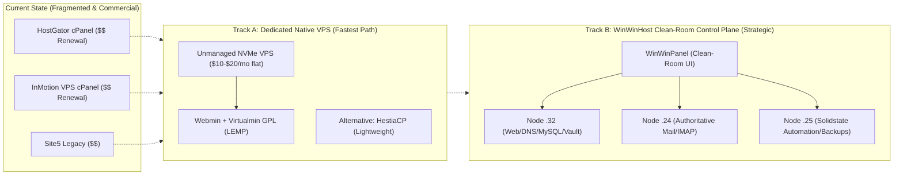

# Executive Summary & Hosting Strategy: cPanel Exit & Open-Source Modernization

## 1. Executive Context & Problem Statement

Client **Vahag Kazanchyan** (`vahag`) operates a portfolio of fabrication, e-commerce, and architectural lettering properties:
1. **`architecturalnumbers.com`**: Active custom metal & acrylic architectural sign-building storefront featuring **Three.js WebGL SignBuilder 2.0** and the **Unified Backend Studio** (`studio.php`), currently hosted on **HostGator Shared/Business cPanel** (`gator3274.hostgator.com:2083`, account `vahag`).
2. **`trace4less.com` & `smooth-curves.com`**: Vectorization and artwork prep engines utilizing procedural PHP 5/7 with the drop-in `mysql_shim.php` compatibility bridge, hosted on an **InMotion Hosting VPS** (`server.trace4less.com` / `144.208.66.217`, account `trace45_vahag`).
3. **`westonletters.com`**: Heritage dimensional letter fabrication brand (established 1965), historically anchored on **Site5** with business email continuity (`sales@westonletters.com` / `vahag_k@hotmail.com`).
4. **`addressnumbersreviews.com`**: Review and social-proof auxiliary property connected to WinWinHost.

### The Problem: The Commercial Control Panel Trap

Over the past decade, cPanel & WHM (acquired by Oakley Capital / WebPros) transitioned from a predictable, fixed-rate hosting utility into an aggressive rent-seeking platform:
* **Account-Based Licensing Traps**: Pricing transitioned from a flat server license to per-account tiers ($30–$60+/month for even modest VPS workloads), with annual price escalations exceeding 15–25% year-over-year.
* **Introductory Rate Expiration**: Shared and managed VPS hosts (HostGator, InMotion, Site5) entice SMBs with steep promotional discounts ($5–$15/mo) that automatically renew at 300%–500% markups ($35–$90/mo for shared; $70–$180+/mo for managed VPS).
* **Proprietary Vendor Lock-In**: Features like MultiPHP, Zone Editor, and AutoSSL are deliberately wrapped in proprietary cPanel hooks (`/usr/local/cpanel/bin/`) that obscure standard Linux system configurations (`/etc/nginx`, `/etc/bind`, `/etc/postfix`, `/etc/php`), making customers believe migrating away requires specialized, expensive operations.
* **Bloatware & Third-Party Upsells**: HostGator's Jupiter cPanel dashboard is heavily contaminated with third-party upsell funnels—CodeGuard, SiteLock, Mojo Marketplace, and Constant Contact—which add zero technical value to production operations while cluttering the administrative interface.

---

## 2. Vahag's True Workload Requirements

A deep audit of Vahag's production codebases, database schemas, and daily operations reveals that his businesses rely on a lean, well-defined set of commodity Linux services:

| Workload Domain | Actual Technical Requirement | cPanel Bloat to Eliminate |
| :--- | :--- | :--- |
| **Web Runtime** | Multi-PHP support: `PHP 7.2` (via `mysql_shim.php` for `trace4less.com`) side-by-side with modern `PHP 8.4-FPM` (for `architecturalnumbers.com` SignBuilder 2.0 / `studio.php`). Static asset caching for Three.js 3D models and high-res video assets. | cPanel EasyApache 4 wrapper scripts, proprietary `.htaccess` passenger handlers, and mod_security upsells. |
| **Databases** | MySQL 8.0 / MariaDB 10.6+ with standard InnoDB storage engine. Direct schema management for `vahag_architecturalnumbers` (`StyleSpecs`, `base_prices`, `characterset`, `orders`) and `vahag_trace4less`. Standard web GUI (`phpMyAdmin` or Adminer). | Proprietary cPanel MySQL Database Wizard wrappers and redundant phpMyAdmin SSO cookie shims. |
| **DNS Management** | Standard RFC1035 zone files: `A`, `AAAA`, `CNAME`, `MX`, `TXT` (SPF, DKIM, DMARC verification). TTL control and zero-downtime cutovers. | Cluttered cPanel Zone Editor with misleading cPanel-specific record validation locks. |
| **Email & Deliverability** | Business IMAP/POP3 mailboxes and authenticated SMTP submission (`sales@westonletters.com`). 100% deliverability with strict DKIM signing, SPF alignment, and DMARC enforcement. Webmail access (`Roundcube`). | Fragmented cPanel "Email Deliverability" wizard that hides raw DNS TXT keys and promotes third-party spam filtering subscriptions. |
| **Storage & Transfers** | Secure SFTP and rsync access, fast zip/tar extraction in browser, and daily incremental offsite backups. | Sluggish cPanel legacy File Manager and slow monolithic `.tar.gz` cPanel backup generation. |
| **Automation** | Standard Linux cron jobs for nightly database backups, invoice reconciliations, and log rotation. | cPanel Cron Jobs wrapper UI. |

---

## 3. Strategic Paths Forward: Dual-Track Roadmap

To eliminate recurring cPanel license fees while safeguarding 100% operational continuity, we define two parallel strategic tracks:

### Track A: Turnkey Native Open-Source Control Panel (Virtualmin / HestiaCP)
* **Target Environment**: A single unmanaged high-performance NVMe cloud VPS (e.g., Linode/Akamai, Hetzner, or InMotion Unmanaged) at a predictable flat rate ($10–$20/month total, with zero per-account license fees).
* **Primary Recommendation**: **Webmin + Virtualmin GPL** running a native LEMP (Nginx + PHP-FPM + MariaDB) stack.
  * **Automated Migration**: Virtualmin has a battle-tested built-in `cpmove` importer (`virtualmin migrate-domain --type cpanel`) that parses cPanel full-backup archives and automatically reconstructs virtual hosts, MySQL databases, mail accounts, and DNS zones in minutes.
  * **Multi-PHP Parity**: Effortlessly provisions multiple Ondřej Surý PHP-FPM packages (`7.2`, `8.1`, `8.2`, `8.3`, `8.4`).
  * **Zero Commercial Upcharges**: 100% open-source GPLv3.

### Track B: WinWinHost Clean-Room Native Hosting ("WinWinPanel")
* **Target Environment**: WinWinHost's existing multi-node private cluster infrastructure (`192.168.11.32` Web/DNS/DB/Vault, `192.168.11.24` Authoritative Mail, `192.168.11.25` Automation Worker).
* **Architecture**: Direct tenant self-service portal integrated into `users_backend` (`:3030`) and `Native Secrets Vault` (`:8200`). Eliminates third-party control panel software entirely by leveraging native Linux system services already provisioned on the cluster.
* **Benefits**: Maximum agency control, bespoke branding, zero third-party attack surface, and seamless integration with Vahag's existing user account (`vahag`) in `multipleDomainCMS`.

---

## 4. Key Milestones & Success Criteria

1. **Complete Discovery & Clean-Room Manifest**: Extract and document 100% of the active cPanel features, configuration models, and UI screens from `architecturalnumbers.com:2083`.
2. **Definitive Open-Source Evaluation**: Produce an objective architectural comparison of Virtualmin, ISPConfig 3, HestiaCP, and Froxlor against Vahag's operational requirements.
3. **Turnkey Migration Playbook**: Provide an actionable, step-by-step runbook for migrating `architecturalnumbers.com` and `trace4less.com` from cPanel to Virtualmin GPL without email disruption or database data loss.
4. **Clean-Room Specification**: Document the complete system design, API contracts, and Linux daemon commands required to deliver a native cPanel equivalent inside WinWinHost.
