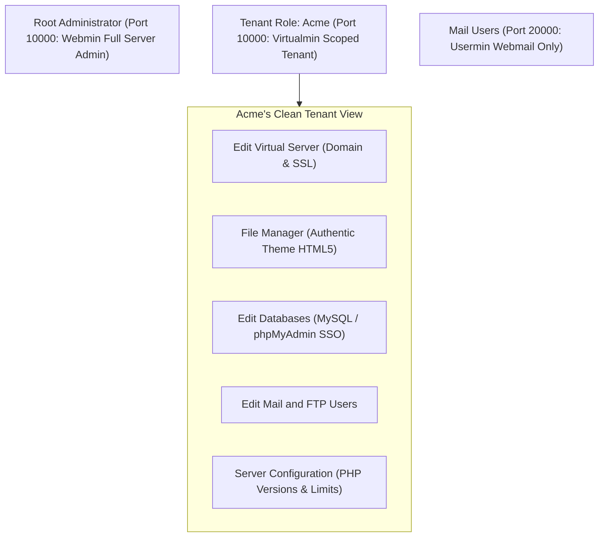

# Webmin & Virtualmin GPL Migration & Customization Playbook

This playbook provides a battle-tested, step-by-step technical runbook to provision **Webmin + Virtualmin GPL** on a clean, unmanaged native Linux VPS (Ubuntu 22.04 or 24.04 LTS), configure Multi-PHP (`PHP 7.2` through `PHP 8.4`), and migrate client properties from HostGator and InMotion Hosting with zero data loss and zero email interruption.

---

## 1. Native LEMP Host Provisioning

Execute on a fresh Ubuntu 22.04 / 24.04 LTS VPS instance (e.g. Linode, Hetzner, or InMotion Unmanaged):

```bash
# 1. Update system packages and configure fully-qualified domain name (FQDN)
sudo apt update && sudo apt upgrade -y
sudo hostnamectl set-hostname panel.example-store.com

# 2. Download and verify official Virtualmin automated installer
curl -O https://software.virtualmin.com/gpl/scripts/virtualmin-install.sh

# 3. Execute installation with LEMP stack (Nginx, PHP-FPM, MariaDB, Postfix, Dovecot, BIND9)
# The --bundle LEMP flag installs high-performance Nginx instead of Apache
sudo /bin/sh virtualmin-install.sh --bundle LEMP --force

# 4. Open required firewall ports in UFW
sudo ufw allow 22/tcp    # SSH
sudo ufw allow 80/tcp    # HTTP
sudo ufw allow 443/tcp   # HTTPS
sudo ufw allow 10000/tcp # Webmin / Virtualmin Admin
sudo ufw allow 20000/tcp # Usermin Webmail
sudo ufw allow 25/tcp    # SMTP
sudo ufw allow 587/tcp   # SMTP Submission
sudo ufw allow 993/tcp   # IMAPS
sudo ufw allow 53        # BIND9 DNS
sudo ufw enable
```

---

## 2. Multi-PHP Runtime Configuration (PHP 7.2 to PHP 8.4)

Tenant workloads require disparate PHP engines:
* **`legacy-crm.org`**: Requires **PHP 7.2** (running with the procedural `mysql_shim.php` compatibility bridge).
* **`example-store.com`**: Requires modern **PHP 8.4** (with OPcache, GD/Imagick, and high-memory limits for Three.js PBR WebGL pipelines and `studio.php`).

Add Ondřej Surý's official PHP repository and install the required engines:

```bash
# Add official repository
sudo add-apt-repository ppa:ondrej/php -y
sudo apt update

# Install legacy PHP 7.2 FPM stack
sudo apt install -y php7.2-fpm php7.2-mysql php7.2-curl php7.2-gd php7.2-mbstring \
  php7.2-xml php7.2-zip php7.2-soap php7.2-bcmath

# Install modern PHP 8.4 FPM stack
sudo apt install -y php8.4-fpm php8.4-mysql php8.4-curl php8.4-gd php8.4-mbstring \
  php8.4-xml php8.4-zip php8.4-soap php8.4-bcmath php8.4-intl php8.4-opcache

# Re-check Virtualmin configuration to auto-detect installed PHP versions
sudo virtualmin check-config
```

---

## 3. Automated cPanel Migration Engine

Virtualmin includes a native parser that reads cPanel `backup-*.tar.gz` archives and automatically reconstructs the virtual host, home directory files, MySQL databases, database users, mailbox accounts (with preserved password hashes), forwarders, and DNS records.

### Step 3.1: Generate cPanel Backup from HostGator
In cPanel (`example-store.com:2083`):
1. Navigate to **Backup** (`backup/index.html`).
2. Click **Download a Full Account Backup**.
3. Select **Home Directory** and enter your email address to receive notification upon completion.
4. Download the generated archive: `backup-MM.DD.YYYY_HH-MM-SS_acme.tar.gz`.

### Step 3.2: Execute Native Virtualmin Migration CLI
Transfer the archive to the new VPS and execute:

```bash
# Execute automated cPanel import
sudo virtualmin migrate-domain \
  --source /root/backup-acme.tar.gz \
  --type cpanel \
  --domain example-store.com \
  --user acme \
  --pass-keep \
  --web \
  --mail \
  --dns \
  --mysql

# Verify domain virtual host creation
sudo virtualmin list-domains --name-only
```

### Step 3.3: Set Custom PHP Version per Domain
```bash
# Assign modern PHP 8.4 to example-store.com
sudo virtualmin set-php-version --domain example-store.com --version 8.4

# Assign legacy PHP 7.2 to legacy-crm.org
sudo virtualmin set-php-version --domain legacy-crm.org --version 7.2
```

---

## 4. White-Labeling & Client Experience Lockdown

To ensure Acme experiences a clean, modern interface without being overwhelmed by root Linux server administration options:



### Hardening Steps:
1. **Restrict Webmin Modules**: Under **Webmin > Webmin Users > `acme`**, disable all system-level modules (Network Configuration, Bootup and Shutdown, Software Package Updates) and restrict access exclusively to **Virtualmin Virtual Servers**.
2. **Authentic Theme Customization**:
   * Navigate to **Webmin > Webmin Configuration > Authentic Theme Configuration**.
   * Set custom branding logo (`Example Store E-Commerce` / `CleanPanel`).
   * Enable dark mode token palette.
3. **Two-Factor Authentication (2FA)**:
   * Enforce TOTP under **Webmin > Webmin Configuration > Two-Factor Authentication**.
4. **Fail2ban Integration**:
   * Verify native jails for Webmin (`[webmin-auth]`), Postfix (`[postfix]`), and Dovecot (`[dovecot]`) are active:
   ```bash
   sudo fail2ban-client status
   ```

---

## 5. Zero-Downtime DNS Cutover & Email Transition Runbook

1. **Pre-Sync Maildirs**:
   Use `imapsync` to mirror historical email from HostGator to the new VPS prior to DNS cutover:
   ```bash
   imapsync --host1 example-store.com --user1 sales@example-store.com --pass1 "..." \
            --host2 panel.example-store.com --user2 sales@example-store.com --pass2 "..."
   ```
2. **Lower DNS TTLs**:
   In HostGator cPanel **Zone Editor**, reduce TTL on `A` and `MX` records from `14400` (4 hours) to `300` (5 minutes) at least 24 hours prior to cutover.
3. **Execute Final Delta Database & Mail Sync**:
   * Place storefront in 60-second maintenance mode.
   * Run `mysqldump` on HostGator and import into new VPS.
   * Run final delta `imapsync`.
4. **Update Nameservers / Apex DNS**:
   * Point `A` record for `example-store.com` to new VPS IP.
   * Point `MX` record to `panel.example-store.com`.
5. **Issue Live Let's Encrypt Certificate**:
   ```bash
   sudo virtualmin generate-cert --domain example-store.com --letsencrypt
   ```
