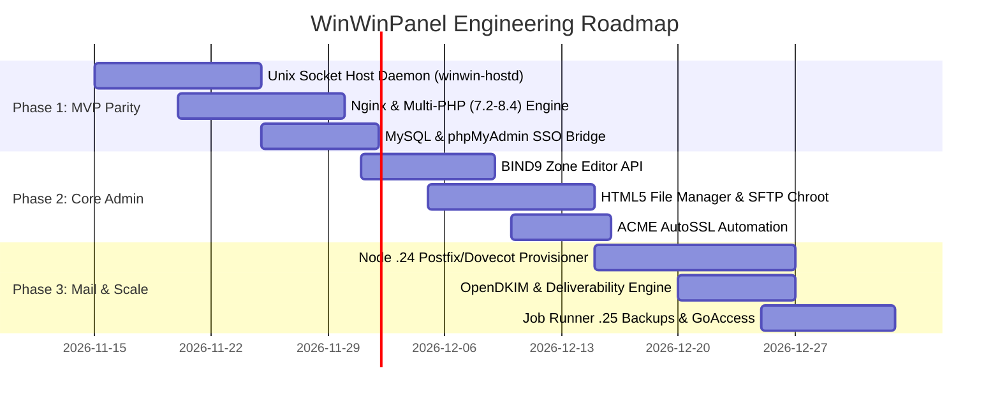

# Clean-Room WinWinHost Control Panel Architecture ("WinWinPanel")

This document details the architectural specification for building a bespoke, high-performance, native Linux control panel ("**WinWinPanel**") engineered directly for the WinWinHost multi-server cluster documented in [`/home/ella/server_profiles/README.md`](/home/ella/server_profiles/README.md).

It replaces legacy commercial control panels with a clean-room, zero-license system running across:
* **Server `.32` (`web`)**: Ingress Nginx, Multi-PHP FPM pools, MySQL 8.0, BIND9 DNS, Native Secrets Vault (`:8200`), and `users_backend` (`:3030`).
* **Server `.24` (`mail`)**: Postfix Inbound/Submission, Dovecot IMAP, SpamAssassin, and OpenDKIM.
* **Server `.25` (`solidstate`)**: Job Runner (`:8084`), Agenda worker queues, GoAccess log processing, and off-host automated backups (strictly respecting the dedicated infrastructure invariant: **Zero Job Runner on Node `.32`**).

---

## 1. Security & Privilege Separation Architecture

Traditional control panels (cPanel, older Webmin, CyberPanel) historically suffered severe vulnerabilities because their web UI ran as `root`, exposing web applications directly to privileged remote code execution.

WinWinPanel enforces strict privilege separation:

```mermaid
flowchart TD
    subgraph Browser["Tenant Browser / REST API / MCP Client"]
        UI["WinWinPanel Preact / Tailwind UI"]
        API["REST / MCP API (JSON-RPC)"]
    end

    subgraph Unprivileged["Unprivileged Control Plane Daemon (:8087)"]
        AUTH["Auth & RBAC Middleware (users_backend :3030 JWT)"]
        VAL["Strict Zod / JSON Schema Validator"]
        SOCKET_CLIENT["Unix Socket IPC Client (/run/winwin/hostd.sock)"]
    end

    subgraph Privileged["Minimal Privileged Host Daemon (winwin-hostd - root)"]
        EXEC["Command Dispatcher (Whitelist Only)"]
        V_NGINX["v-nginx (Virtualhost Compiler)"]
        V_DNS["v-dns (BIND9 RFC1035 Compiler)"]
        V_PHP["v-php (FPM Pool Manager)"]
        V_DB["v-mysql (MySQL Socket Client)"]
        V_USER["v-user (System Accounts & Quotas)"]
    end

    UI --> API
    API --> AUTH
    AUTH --> VAL
    VAL --> SOCKET_CLIENT
    SOCKET_CLIENT -->|Unix Domain Socket (0600 root:winwin)| EXEC
    EXEC --> V_NGINX
    EXEC --> V_DNS
    EXEC --> V_PHP
    EXEC --> V_DB
    EXEC --> V_USER
```

### Core Security Rules:
1. **Unprivileged Web Gateway**: The web server, UI, and API run as user `winwin-panel` (UID 1040, non-root).
2. **Atomic Action Wrappers**: The root daemon (`winwin-hostd`) does not execute arbitrary shell strings. It only accepts strongly typed JSON commands over a local Unix domain socket (`/run/winwin/hostd.sock`), executing discrete, hardened scripts (modeled after Hestia's atomic `v-*` primitives).
3. **Strict Path Canonicalization**: All file operations (upload, edit, extract, delete) enforce `realpath()` checks confining operations within the tenant's designated chroot home (`/home/tenants/<tenant>/`).

---

## 2. Identity, RBAC & Secrets Vault Integration

WinWinPanel seamlessly integrates with the existing identity model established in `multipleDomainCMS`:

### 2.1 User Accounts & Role Mapping
Directly binds to `data/users.json` and `users_backend` (`:3030`):
* **Client User**: `username: "vahag"`, `client_id: "vahag"`.
* **Authorized Domains**: `managedDomains: ["architecturalnumbers.com", "westonletters.com", "trace4less.com", "smooth-curves.com", "addressnumbersreviews.com"]`.
* **RBAC Enforcement**: A tenant can only create, modify, inspect, or delete resources (DNS zones, databases, mailboxes, PHP settings) associated with their declared `managedDomains`.

### 2.2 Native Secrets Vault Integration (`127.0.0.1:8200`)
Rather than storing plaintext database passwords and API tokens in flat files, WinWinPanel writes and retrieves tenant credentials via the Native Secrets Vault daemon:
* Vault Path: `secret/data/tenants/<tenant>/<resource>`
* Stored Keys:
  * `MYSQL_PASSWORD`: Per-database random 32-character high-entropy secret.
  * `ACME_ACCOUNT_KEY`: Cryptographic key for Let's Encrypt DNS-01 challenges.
  * `MAIL_DKIM_PRIVKEY`: 2048-bit RSA / Ed25519 private signing key for Postfix/OpenDKIM.

---

## 3. Subsystem Implementation Specifications

### 3.1 Web & Multi-PHP Engine (Node `.32`)
* **Tenant User Isolation**:
  ```bash
  useradd -m -d /home/tenants/architec -s /bin/false -G sftponly architec
  chmod 750 /home/tenants/architec
  ```
* **Systemd Resource Slices**:
  Each tenant runs within a dedicated systemd slice (`user-architec.slice`):
  ```ini
  [Slice]
  CPUQuota=200%
  MemoryMax=2G
  TasksMax=100
  ```
* **Isolated PHP-FPM Pools**:
  Each domain is assigned a dedicated pool socket located at `/run/php/php<ver>-fpm-<domain>.sock`:
  ```ini
  ; /etc/php/8.4/fpm/pool.d/architecturalnumbers.com.conf
  [architecturalnumbers.com]
  user = architec
  group = architec
  listen = /run/php/php8.4-fpm-architecturalnumbers.com.sock
  listen.owner = www-data
  listen.group = www-data
  listen.mode = 0660
  pm = dynamic
  pm.max_children = 10
  pm.start_servers = 2
  pm.min_spare_servers = 1
  pm.max_spare_servers = 3
  php_admin_value[open_basedir] = /home/tenants/architec/public_html:/tmp
  ```
* **Nginx Virtual Host Compilation**:
  Generated from templates in `/etc/nginx/sites-available/<domain>.conf` and validated via `nginx -t` before issuing `systemctl reload nginx`.

---

### 3.2 DNS Zone Engine (Node `.32` BIND9)
* **JSON-to-RFC1035 Compiler**:
  Converts tenant zone records into standard BIND9 files (`/var/named/zones/<domain>.db`):
  ```bind
  $TTL 300
  @       IN      SOA     ns1.winwinhost.com. hostmaster.winwinhost.com. (
                          2026111101 ; Serial
                          10800      ; Refresh
                          3600       ; Retry
                          604800     ; Expire
                          300 )      ; Minimum
  @       IN      NS      ns1.winwinhost.com.
  @       IN      NS      ns2.winwinhost.com.
  @       IN      A       192.168.11.32
  mail    IN      A       192.168.11.24
  @       IN      MX      10 mail.architecturalnumbers.com.
  @       IN      TXT     "v=spf1 ip4:192.168.11.24 ~all"
  default._domainkey IN TXT "v=DKIM1; k=rsa; p=..."
  _dmarc  IN      TXT     "v=DMARC1; p=quarantine; rua=mailto:dmarc@architecturalnumbers.com"
  ```
* **Pre-Commit Validation**:
  Executes `named-checkzone <domain> /var/named/zones/<domain>.db`. If valid, triggers `rndc reload <domain>`.

---

### 3.3 Database & SSO Engine (Node `.32` MySQL 8.0)
* **Schema Prefixing**:
  Enforces strict naming `<tenant>_<dbname>` (e.g. `architec_storefront`, `architec_signbuilder`).
* **Root Socket Invocation**:
  ```sql
  CREATE DATABASE `architec_storefront` CHARACTER SET utf8mb4 COLLATE utf8mb4_unicode_ci;
  CREATE USER 'architec_dbuser'@'localhost' IDENTIFIED BY '<vault_secret>';
  GRANT ALL PRIVILEGES ON `architec_storefront`.* TO 'architec_dbuser'@'localhost';
  FLUSH PRIVILEGES;
  ```
* **phpMyAdmin Single-Sign-On (SSO)**:
  Uses phpMyAdmin's `SignonSession` mechanism. When a tenant clicks "Open phpMyAdmin", WinWinPanel generates an encrypted HMAC session token with temporary MySQL user credentials, redirecting to `https://db.winwinhost.com/signon.php` with zero manual login prompts.

---

### 3.4 File Manager & SFTP (Node `.32`)
* **Chrooted SFTP (`/etc/ssh/sshd_config`)**:
  ```ssh
  Match Group sftponly
      ChrootDirectory /home/tenants/%u
      ForceCommand internal-sftp -u 0022
      AllowTcpForwarding no
      X11Forwarding no
  ```
* **Modern Web File Manager**:
  Clean HTML5 File Manager supporting multi-part chunked upload, code syntax highlighting (Monaco / CodeMirror), archive extraction (`.zip`, `.tar.gz`, `.tar.bz2`), and POSIX chmod management.

---

### 3.5 Mail & Deliverability Engine (Node `.24`)
* **Remote RPC Integration**:
  Node `.32` communicates with Node `.24` over an internal mTLS wireguard link (`192.168.11.24:8089`).
* **MySQL-Backed Virtual Mailboxes**:
  Postfix and Dovecot query virtual mailbox tables (`virtual_domains`, `virtual_users`, `virtual_aliases`).
* **Automated DKIM Generation**:
  Runs `opendkim-genkey -b 2048 -d <domain> -s default` on Node `.24`, extracts the public key, and automatically pushes the TXT record to Node `.32` BIND9 DNS.
* **Roundcube Webmail SSO**:
  Passes pre-authenticated tokens via Roundcube's `autologin` plugin.

---

### 3.6 Automation & Observability Engine (Node `.25` `solidstate`)
* **Dedicated Compute Separation**:
  All heavy scheduled tasks run on `solidstate` (`192.168.11.25:8084`), leaving Node `.32` 100% dedicated to web traffic.
* **Incremental Backups**:
  Job Runner triggers nightly `restic` backups over SSH:
  ```bash
  restic -r sftp:backup@nas.lan:/backups/tenants backup /home/tenants/architec \
    --exclude "*/cache/*" --exclude "*/tmp/*"
  ```
* **Traffic Analytics (GoAccess)**:
  Job Runner parses Nginx access logs every 15 minutes, generating real-time static JSON/HTML reports:
  ```bash
  goaccess /var/log/nginx/architecturalnumbers.com.access.log -o /home/tenants/architec/stats/index.html --log-format=COMBINED
  ```

---

## 4. Phased Implementation Roadmap


