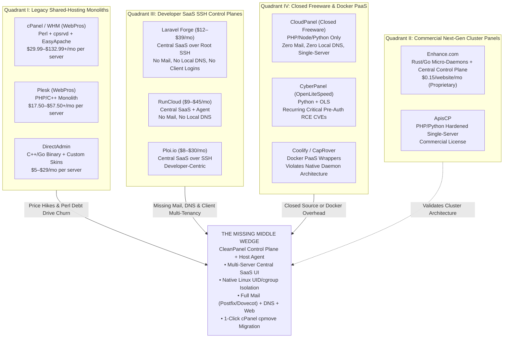

# 07 — Commercial & SaaS Server Control Panel Market Landscape

> **Executive Summary:** Before deciding whether to fork an open-source panel or build a clean-room control plane, we must map the full commercial and SaaS market landscape. The server management industry has bifurcated into two flawed extremes: **Legacy Shared-Hosting Monoliths** (`cPanel/WHM`, `Plesk`, `DirectAdmin`) burdened by 20-year-old Perl/PHP codebases and predatory per-account pricing, and **Developer App Deployers** (`Laravel Forge`, `RunCloud`, `Ploi.io`, `CloudPanel`) that completely abandon multi-tenant end-client isolation, authoritative DNS, and native email hosting. This bifurcation exposes a massive **"Missing Middle" market wedge**: a multi-server SaaS control plane backed by a lightweight, zero-dependency Go host agent that delivers full agency/client multi-tenancy, native mail & DNS, and 1-click `cpmove` migration.

---

## 1. The Four Market Quadrants

To evaluate where a new SaaS/open-source control panel product sits, we classify every major commercial and freeware competitor into four architectural quadrants:

1. **Quadrant I — Legacy Shared-Hosting Monoliths:** `cPanel & WHM`, `Plesk` (both WebPros portfolio companies), and `DirectAdmin`.
2. **Quadrant II — Commercial Next-Gen Cluster Panels:** `Enhance` (by Hosting.co.uk) and `ApisCP`.
3. **Quadrant III — Developer SaaS SSH Control Planes:** `Laravel Forge`, `RunCloud`, `Ploi.io`, `SpinupWP`, and `ServerPilot`.
4. **Quadrant IV — Single-Server Closed Freeware & Docker Wrappers:** `CloudPanel` (MGT-Commerce), `KeyHelp`, `FastPanel`, `aaPanel`, `CyberPanel` (OpenLiteSpeed), `Coolify`, and `CapRover`.

---

## 2. Quadrant I: Legacy Shared-Hosting Monoliths (`cPanel`, `Plesk`, `DirectAdmin`)

### 2.1 The WebPros Monopoly (`cPanel/WHM` & `Plesk`)
Since Oakley Capital / WebPros acquired both `cPanel` and `Plesk` and transitioned from flat per-server licensing to **tiered per-account metering** in 2019 (followed by six consecutive annual price increases through 2026), independent agencies and mid-market hosting providers have faced 300%–800% license cost inflation.

| Metric | cPanel & WHM (Observed on `example-store.com`) | Plesk Obsidian | DirectAdmin |
| :--- | :--- | :--- | :--- |
| **Owner / License** | WebPros (Proprietary Commercial) | WebPros (Proprietary Commercial) | JBMC Software (Proprietary Commercial) |
| **Core Runtime** | Perl 5 (`cpsrvd`), custom RPM/apt `ea-*` packages | Proprietary PHP + C++ `sw-engine` | Compiled C++/Go binary + PHP plugins |
| **Multi-Server Architecture** | Single-server monolith (`WHM` per box; DNSOnly is separate) | Single-server monolith (Plesk Multi-Server deprecated) | Single-server monolith |
| **Idle RAM Footprint** | `1.5 GB – 2.5 GB` RAM minimum | `1.2 GB – 2.0 GB` RAM minimum | `300 MB – 600 MB` RAM |
| **Multi-Tenant Isolation** | Linux UID + optional CloudLinux CageFS ($16/mo extra) | Linux UID + `chroot` subscription | Linux UID + Bubblewrap / CloudLinux |
| **Backup Archive Format** | **`cpmove-<user>.tar.gz`** (De-facto industry standard) | Plesk XML/tar dump | DirectAdmin `user.*.tar.gz` |
| **Why Agencies Stay** | 68 integrated tools (Mail, DNS, File Manager, Multi-PHP, `cpmove`) | WordPress Toolkit + Windows/Linux support | Drop-in low-cost cPanel clone with `cpmove` import |
| **Why Agencies Leave** | Annual per-account price hikes; heavy resource footprint; dated Perl UI | Same WebPros parent company & annual price escalations | Dated architecture; single-server management model |

### 2.2 Key Takeaway from Quadrant I
As documented in [01-executive-summary-and-strategy.md](file:///home/robert/projects/cpanel-clean-room/docs/01-executive-summary-and-strategy.md) and captured empirically in [cpanel_feature_manifest.json](file:///home/robert/projects/cpanel-clean-room/docs/data/cpanel_feature_manifest.json), our live audit of reference tenant `acme`'s HostGator account (`example-store.com`) proved that even a 10+ year legacy cPanel user relies on **only ~18 core operational capabilities** (Multi-domain vhosts, Multi-PHP FPM `5.6`–`8.5`, AutoSSL, Authoritative DNS Zone Editor, Email Accounts + DKIM/SPF/DMARC + Forwarders, MySQL DBs + phpMyAdmin, Web File Manager, Backup Wizard, and Cron). The remaining 50+ widgets are upsell wrappers, legacy CGI relics, or redundant wizards.

---

## 3. Quadrant II: Commercial Next-Gen Cluster Panels (`Enhance`, `ApisCP`)

### 3.1 `Enhance.com` (The Closest Commercial Validation of Our Target Architecture)
`Enhance` (developed by Hosting.co.uk) is the most instructive commercial entrant in the hosting panel market over the past five years:
- **What Enhance Got Right:**
  - Separated the **Central Control Plane UI** from lightweight **Role-Based Server Agents** (Application, Database, Email, DNS, Backup roles).
  - Built a first-class **cPanel `cpmove` Importer** that allows agencies to drag-and-drop a `backup-*.tar.gz` file and hydrate websites, databases, mail accounts, and DNS zones onto a fresh cluster.
  - Designed native **Organization → Reseller → Customer** multi-tenancy from Day 1.
- **Where Enhance Falls Short for Our Use Case:**
  - **100% Proprietary & Closed Source:** Cannot be self-hosted without paying per-website licensing fees (`$0.15/website/month`) tethered to their licensing servers.
  - **Container Overhead on Website Runtimes:** Enhance relies heavily on per-website containerization rather than ultra-lean native `systemd` + `php-fpm` socket pools with kernel `cgroups v2`.

---

## 4. Quadrant III: Developer SaaS Control Planes (`Laravel Forge`, `RunCloud`, `Ploi.io`, `SpinupWP`)

Developer-focused SaaS control planes pioneered the **Central SaaS Dashboard + Remote Server Provisioning** business model (`$12–$45/month` flat subscription for managing multiple VPS nodes on Hetzner, DigitalOcean, Linode, or bare metal).

| Capability | Laravel Forge | RunCloud | Ploi.io | SpinupWP | **cPanel Baseline (`acme`)** |
| :--- | :--- | :--- | :--- | :--- | :--- |
| **Central Multi-Server Dashboard** | ✅ Yes (SaaS) | ✅ Yes (SaaS) | ✅ Yes (SaaS) | ✅ Yes (SaaS) | ❌ No (1 WHM per server) |
| **Provisioning Transport** | Root SSH execution | Custom Agent + SSH | Root SSH execution | Root SSH execution | Local `cpsrvd` |
| **Multi-PHP FPM Orchestration** | ✅ Yes | ✅ Yes | ✅ Yes | ✅ Yes | ✅ Yes (`ea-php81`–`85`, `alt-php56`) |
| **Node.js / Reverse Proxy Apps** | ✅ Basic | ✅ Basic | ✅ Yes | ❌ WordPress only | ⚠️ Limited (`Passenger`) |
| **End-Client Isolated Sub-Logins** | ❌ No | ⚠️ Team sharing only | ⚠️ Basic panel | ❌ No | ✅ Full Linux UID + cPanel login |
| **Native Email Hosting (IMAP/SMTP)** | ❌ **None** | ❌ **None** | ❌ **None** | ❌ **None** | ✅ Full (`Exim`/`Dovecot`/Roundcube) |
| **Local Authoritative DNS Server** | ❌ External API only | ❌ External API only | ❌ External API only | ❌ External API only | ✅ Full (`Bind`/`PowerDNS`) |
| **Web File Manager & Code Editor** | ❌ None | ⚠️ Limited | ⚠️ Basic | ❌ None | ✅ Full Web File Manager |
| **cPanel `cpmove` Backup Importer** | ❌ None | ❌ None | ❌ None | ❌ None | ✅ Native format |

> [!IMPORTANT]
> **Why Developer SaaS Panels Cannot Replace cPanel for Agency Clients:**
> When an agency migrates a tenant like `acme` (`example-store.com`, `legacy-crm.org`, `directory-hub.net`) off HostGator cPanel, the tenant expects their existing `@example-store.com` IMAP mailboxes, forwarders, autoresponders, MySQL databases, and browser File Manager to keep working. `Laravel Forge`, `RunCloud`, and `SpinupWP` tell the user to *"go pay Google Workspace \$7/user/month for email and use SFTP instead of a File Manager."* For an agency managing 30 domains with 100 mailboxes, that destroys the unit economics of leaving cPanel.

---

## 5. Quadrant IV: Closed Freeware & Docker PaaS Wrappers (`CloudPanel`, `CyberPanel`, `Coolify`)

### 5.1 `CloudPanel` (MGT-Commerce)
We scored `CloudPanel` as a proprietary reference baseline in [competitor_gap_matrix.json](file:///home/robert/projects/cpanel-clean-room/docs/data/competitor_gap_matrix.json), where it achieved only **55.7% cPanel feature parity** (`67.5%` on P0 features) and **25.0% SaaS Product Fit**:
- **Closed Source:** Despite being free to download, CloudPanel's core provisioning engine is closed-source proprietary software—making it legally impossible to fork, white-label, or embed into a commercial product.
- **Zero Mail & Zero Local DNS:** Like Forge and RunCloud, CloudPanel completely omits Postfix/Dovecot email hosting, Roundcube webmail, and local BIND/PowerDNS authoritative zone serving.
- **No cPanel Importer:** Offers no automated migration path for `cpmove` archives.

### 5.2 `CyberPanel` (OpenLiteSpeed)
- Built in Python around OpenLiteSpeed (`OLS`).
- Suffers from a catastrophic security track record, including unauthenticated root Remote Code Execution (RCE) vulnerabilities exploited in the wild by ransomware botnets (e.g., the late-2024 PSAUX/CyberPanel pre-auth command injection wave affecting 20,000+ servers).
- Ties the entire hosting stack to LiteSpeed's `.htaccess` dialect rather than clean Nginx/Caddy + standard Linux primitives.

### 5.3 Docker PaaS Wrappers (`Coolify`, `CapRover`, `Dokploy`)
- In accordance with our **System Preferences Invariant (Native Installations over Docker)**, Docker-based PaaS panels are disqualified as a cPanel replacement architecture.
- Running separate Docker containers per PHP website, per MariaDB instance, and per mail daemon introduces massive memory overhead, Docker bridge network NAT complexity, overlayfs I/O degradation, and broken quota reporting compared to native Linux `systemd` slices, Unix domain sockets, and `ext4`/`xfs` project quotas.

---

## 6. Strategic Synthesis: The "Missing Middle" Product Wedge

Combining the empirical baseline from [02-complete-feature-inventory.md](file:///home/robert/projects/cpanel-clean-room/docs/02-complete-feature-inventory.md) with the four-quadrant market map reveals a clear, defensible market wedge:

1. **Developer SaaS Experience (Like Laravel Forge / RunCloud):** A single, blazing-fast TypeScript/React central control plane that manages unlimited remote Ubuntu/Debian servers over mutual TLS (`mTLS`).
2. **Full Shared-Hosting Multi-Tenancy & Mail/DNS Completeness (Like cPanel / Virtualmin):** Every managed node natively runs Nginx, Multi-PHP FPM (`5.6`–`8.5`), MariaDB, Postfix + Dovecot + Rspamd, and PowerDNS/Cloudflare sync—with strict per-tenant Linux UID and `systemd` `cgroups v2` resource isolation.
3. **Zero Legacy Language Debt:** Instead of 733,000 lines of Perl (`Webmin/Virtualmin`), 247,000 lines of legacy PHP (`ISPConfig`), or 526 `sudo`-invoked Bash scripts (`HestiaCP`), the remote node runs a **single compiled Go binary (`winwin-agentd`)** paired with battle-tested, permissively licensed (`MIT`/`Apache-2.0`) single-binary subsystems (`FileBrowser`, `ttyd`, `GoAccess`).
4. **1-Click `cpmove` Escape Hatch:** Any agency or SMB customer can upload their HostGator/Bluehost/GoDaddy `backup-*.tar.gz` archive and be live on a clean VPS in under 5 minutes.

In [08-empirical-open-source-codebase-and-security-audit.md](file:///home/robert/projects/cpanel-clean-room/docs/08-empirical-open-source-codebase-and-security-audit.md), we prove why none of the existing open-source panels can simply be forked to achieve this vision—and exactly which open-source components we *can* leverage safely.
