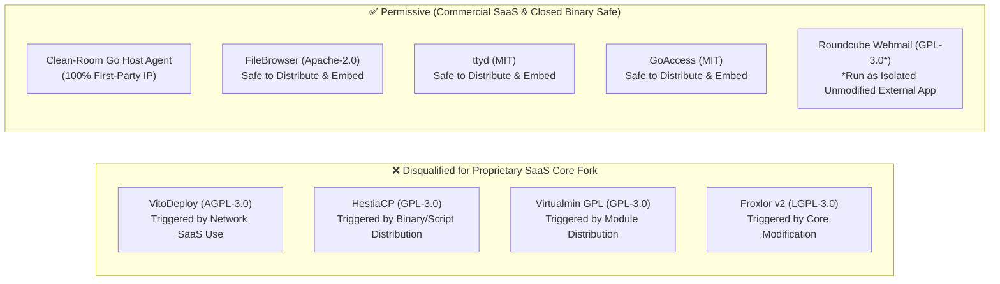

# 08 — Empirical Open-Source Codebase & Security Audit

> **Executive Summary:** Using [`scripts/audit_competitor_repos.mjs`](file:///home/robert/projects/cpanel-clean-room/scripts/audit_competitor_repos.mjs), we shallow-cloned 11 open-source control panels and composable Linux subsystem repositories into `scratch/competitor-repos/` and programmatically measured their exact Lines of Code (LOC), language composition, CLI/API surface area, privilege boundaries, copyleft licensing restrictions, and published GitHub Security Advisories (`GHSA` / `CVE`). Every metric in this document is backed by [`docs/data/competitor_empirical_metrics.json`](file:///home/robert/projects/cpanel-clean-room/docs/data/competitor_empirical_metrics.json).

---

## 1. Empirical Source-Tree Comparison Matrix

The table below summarizes the exact file counts, non-blank code lines, primary language distribution, license classifications, and published security advisories measured by [`scripts/audit_competitor_repos.mjs`](file:///home/robert/projects/cpanel-clean-room/scripts/audit_competitor_repos.mjs):

| Project | Role | SPDX License | Commercial SaaS Fork Viable? | Total Files | Total Code LOC | Primary Language Breakdown | Published GitHub Advisories (`GHSA`) |
| :--- | :--- | :--- | :--- | ---: | ---: | :--- | ---: |
| **Webmin (Core)** | Full Sysadmin Panel | `BSD-3-Clause` | ✅ Yes (Core only) | `44,225` | `528,311` | Perl: `439,315` (`3,701` files) JS: `51,185` / HTML: `24,724` | `3` |
| **Virtualmin GPL** | Hosting Module (`cpmove`) | `GPL-3.0` | ❌ No (Strong Copyleft) | `13,390` | `205,530` | Perl: `181,492` (`480` files) HTML: `23,315` / Shell: `356` | `0` (tracked in Webmin) |
| **ISPConfig 3** | Multi-Server Hosting Panel | `BSD-3-Clause` | ✅ Yes (Permissive) | `8,875` | `247,313` | PHP: `174,971` (`1,945` files) JS: `30,800` / HTML: `25,084` / TS: `7,635` | `N/A` (GitLab hosted) |
| **HestiaCP** | Single-Server Hosting Panel | `GPL-3.0` | ❌ No (Strong Copyleft) | `1,567` | `110,151` | Shell: `65,725` (`675` files) PHP: `35,233` (`320` files) / JS: `4,296` | **`26`** |
| **Froxlor v2** | JSON-RPC Hosting Panel | `LGPL-3.0` | ❌ No (Core Fork Copyleft) | `571` | `108,131` | PHP: `103,085` (`356` files) HTML/Twig: `3,812` (`146` files) | **`30`** |
| **AcePanel (RatPanel)** | Single-Binary Go Panel | `BSD-3-Clause` | ✅ Yes (Permissive) | `1,371` | `178,366` | Go: `107,182` (`685` files) Vue: `62,039` (`263` files) / TS: `8,682` | `1` (`CVE-2025-53534`) |
| **VitoDeploy** | Central SSH App Deployer | `AGPL-3.0` | ❌ **Banned (Network AGPL)** | `2,683` | `174,079` | PHP: `131,858` (`1,754` files) TS: `40,866` (`489` files) / Shell: `919` | `1` (`CVE-2026-29789`) |
| **Ajenti 2** | Python Sysadmin Dashboard | `MIT` | ✅ Yes (Permissive) | `2,050` | `16,292` | Python: `8,892` (`279` files) HTML: `3,761` / JS: `2,228` / TS: `1,001` | `9` (`CVE-2026-79920`) |
| **FileBrowser** | Composable File Manager | `Apache-2.0` | ✅ Yes (Permissive) | `265` | `28,911` | Go: `13,457` (`85` files) Vue: `8,845` (`59` files) / TS: `3,660` | **`30`** |
| **ttyd** | Composable Web Terminal | `MIT` | ✅ Yes (Permissive) | `43` | `19,441` | C/C++: `18,120` (`14` files) HTML: `1,259` / Shell: `62` | **`0`** |
| **GoAccess** | Composable Log Analytics | `MIT` | ✅ Yes (Permissive) | `149` | `46,974` | C/C++: `41,206` (`91` files) JS: `3,221` / CSS: `1,531` | `4` |

---

## 2. Deep-Dive Source Teardowns of Full Control Panels

### 2.1 `HestiaCP` (`110,151 LOC` — `GPL-3.0`)
- **Source Architecture (`scratch/competitor-repos/hestiacp`):**
  - Forked from VestaCP, HestiaCP is split into two halves: `bin/v-*` (`526` Bash scripts totaling `65,725 LOC`) and `web/` (`320` PHP files totaling `35,233 LOC`).
  - Our automated script classified all **526 `v-*` CLI scripts** across 11 operational domains:
    - `user`: `100` scripts (`v-add-user`, `v-change-user-config-value`, etc.)
    - `web`: `76` scripts (`v-add-web-domain`, `v-add-web-domain-ssl`, etc.)
    - `mail`: `67` scripts (`v-add-mail-domain`, `v-add-mail-account`, `v-add-mail-domain-dkim`, etc.)
    - `dns`: `51` scripts (`v-add-dns-domain`, `v-add-dns-record`, etc.)
    - `backup`: `40` scripts (`v-backup-user`, `v-restore-user`, etc.)
    - `database`: `30` scripts (`v-add-database`, `v-add-database-user`, etc.)
    - `ssl`: `27` scripts (`v-add-letsencrypt-domain`, `v-update-letsencrypt-ssl`, etc.)
    - `firewall`: `21` scripts (`v-add-firewall-rule`, `v-add-firewall-ban`, etc.)
    - `cron`: `19` scripts (`v-add-cron-job`, `v-delete-cron-job`, etc.)
    - `sys / other`: `95` scripts
- **Why HestiaCP Fails as a Fork Target:**
  1. **Systemic Privilege Escalation Surface (`26` Published GHSAs):** The PHP web UI runs as `hestiaweb` and invokes `sudo /usr/local/hestia/bin/v-*` with string-interpolated arguments. This design has produced **26 GitHub Security Advisories**, including Critical/High root RCEs:
     - `GHSA-q3m6-6pq7-2vgr` (`CVE-2025-27799`, Critical): Arbitrary Code Execution as `root` via CLI command parsing.
     - `GHSA-whvg-4fmh-9rxg` (`CVE-2024-37303`, Critical): Command Injection in `v-Check-User-Password`.
     - `GHSA-jhgf-cvhh-vr4x` (`CVE-2024-25122`, High): Privilege Escalation in `v-change-user-config-value`.
     - `GHSA-54r9-vp89-25w2` (`CVE-2024-25123`, High): Privilege Escalation via unsafe temp file handling in `v-copy-fs-directory`.
  2. **Strong `GPL-3.0` Copyleft:** Any derivative work distributed to customer servers must release its complete source code under `GPLv3`.
  3. **No Native `cpmove` Importer & Single-Server Lock-In:** Lacks native cPanel backup ingestion and couples the UI directly to local filesystem paths.

---

### 2.2 `Webmin` (`528,311 LOC` — `BSD-3-Clause`) + `Virtualmin GPL` (`205,530 LOC` — `GPL-3.0`)
- **Source Architecture (`scratch/competitor-repos/webmin` & `virtualmin-gpl`):**
  - Together, Webmin and Virtualmin comprise **`733,841` non-blank lines of code** (`620,807 LOC` of Perl 5 across `4,181` `.pl`/`.pm`/`.cgi` files).
  - Webmin Core contains **`135` system administration modules** (`apache`, `bind8`, `mysql`, `postfix`, `dovecot`, `fail2ban`, `firewalld`, `lvm`, `smart-status`, `useradmin`, etc.) running inside a custom Perl HTTP server (`miniserv.pl`) as `root`.
  - Virtualmin GPL adds **`226` Perl CLI/CGI scripts** and **`5` dedicated competitor migration parsers**:
    - `migration-cpanel.pl` (**`1,702` lines of Perl** — the gold-standard open-source reference for unpacking `cpmove-<user>.tar.gz` archives, parsing `cp/<user>`, `Mysql/`, `homedir/mail/`, `dnszones/*.db`, and `ssl/`).
    - `migration-directadmin.pl`, `migration-plesk.pl`, `migration-plesk9.pl`, and `migration-ensim.pl`.
- **Why Webmin/Virtualmin Fails as a Direct Fork Target (Strategy 1) — But Succeeds as a Specification Reference:**
  1. **620k+ Lines of Perl 5 Technical Debt:** Building a modern TypeScript/Go SaaS engineering team around a 28-year-old Perl 5 CGI codebase is untenable.
  2. **Split License Trap (`BSD-3-Clause` vs. `GPL-3.0`):** While Webmin Core is `BSD-3-Clause`, **Virtualmin GPL** (where all multi-tenant virtual server, mail, DNS, and `cpmove` hosting logic lives) is strictly **`GPL-3.0`** because the authors sell `Virtualmin Pro` commercially.
  3. **Clean-Room Value of `migration-cpanel.pl`:** At only `1,702` lines of code, Virtualmin's `migration-cpanel.pl` proves that full cPanel `cpmove` archive ingestion is a compact, deterministic file-mapping problem that we can cleanly implement in ~900 lines of Go/TypeScript without inheriting `GPL-3.0` code.

---

### 2.3 `ISPConfig 3` (`247,313 LOC` — `BSD-3-Clause`)
- **Source Architecture (`scratch/competitor-repos/ispconfig3`):**
  - ISPConfig 3 is the most mature **permissively licensed (`BSD-3-Clause`)** multi-server panel in existence (`247,313 LOC`, including `174,971 LOC` of PHP).
  - Our source audit extracted:
    - **`10` Remote API Traits** exposing **`309` SOAP/REST methods** (`remoting_client`, `remoting_domains`, `remoting_dns`, `remoting_mail`, `remoting_sites`, `remoting_sites_database`, `remoting_Server`, `remoting_admin`, `remoting_vm`).
    - **`37` Server Agent Plugins** in `server/plugins-available/` (`nginx_plugin`, `apache2_plugin`, `bind_plugin`, `powerdns_plugin`, `postfix_server_plugin`, `dovecot_plugin`, `rspamd_plugin`, `mysql_clientdb_plugin`, `cron_jailkit_plugin`, `shelluser_jailkit_plugin`, `firewall_plugin`, etc.).
- **Why ISPConfig 3 Is Viable Only as a Headless Bridge (Strategy 2), Not a Long-Term Product Codebase:**
  1. **60-Second Cron Polling Architecture:** ISPConfig's server agent (`server.sh`) runs via a once-per-minute root cron job that polls a MySQL `sys_datalog` table. In a modern SaaS UI, making users wait up to 60 seconds with no real-time streaming feedback when creating a database or issuing an SSL certificate feels broken.
  2. **175k LOC of Custom Non-Framework PHP:** ISPConfig uses its own 2008-era PHP templating and form framework (`tform`), lacks a built-in Web File Manager (`0%`) or Web Terminal (`0%`), and sells its cPanel migration tool as a proprietary closed-source add-on (`ISPConfig Migration Toolkit`, EUR 59).

---

### 2.4 `Froxlor v2` (`108,131 LOC` — `LGPL-3.0`)
- **Source Architecture (`scratch/competitor-repos/froxlor-v2`, branch `v2`):**
  - Contains `103,085 LOC` of PHP across `356` files, structured around a clean JSON-RPC API (`lib/Froxlor/Api/Commands/`) with **`26` command modules** and **`150` CRUD methods** (`Admins`, `Certificates`, `Cronjobs`, `Customers`, `DomainZones`, `Domains`, `EmailAccounts`, `EmailDomains`, `EmailForwarders`, `FpmDaemons`, `HostingPlans`, `Mysqls`, `PhpSettings`, `SubDomains`, etc.).
- **Why Froxlor v2 Fails our Security & Completeness Gates:**
  1. **Wave of Multi-Tenant Authorization & Root Escalation Advisories (`30` GHSAs):** Our GitHub Security Advisory query uncovered **30 published advisories**, including an October 2026 cluster of multi-tenant privilege escalations:
     - `GHSA-vwjv-x8ff-4cvv` (High, Oct 2026): Local privilege escalation to `root` via missing symlink containment in the root traffic cron's `chown -R`, enabling takeover of any host directory.
     - `GHSA-5fm2-8wxf-xc5v` (High, Oct 2026): Unscoped API keys listing leaks every account's API key and secret, enabling super-admin takeover.
     - `GHSA-pp2f-frcg-w8rv` & `GHSA-m7gc-8c8g-4f89` (Medium, Oct 2026): Missing authorization checks in `SubDomains.delete` and `Admins.get` allowing cross-tenant tampering.
  2. **Missing Core cPanel Tools:** No built-in Web File Manager, no Web Terminal, no cPanel `cpmove` importer, and cron-delayed configuration generation.

---

### 2.5 `AcePanel / RatPanel` (`178,366 LOC` — `BSD-3-Clause`)
- **Source Architecture (`scratch/competitor-repos/acepanel`):**
  - Written in modern **Go (`107,182 LOC` across `685` files)** + **Vue/TypeScript (`70,721 LOC`)** under the permissive **`BSD-3-Clause`** license.
  - Well-organized Go packages in `pkg/` (`acme`, `cert`, `chattr`, `db`, `fastcgi`, `firewall`, `os`, `shell`, `ssh`, `systemctl`, `tlscert`, `webserver`) and `internal/` (`app`, `apps`, `biz`, `command`, `data`, `job`, `middleware`, `migration`, `route`, `service`, `taskqueue`).
- **Why AcePanel Cannot Simply Be Re-Skinned as a cPanel Replacement:**
  1. **Zero Multi-Tenant Linux UID Isolation:** AcePanel is modeled after `aaPanel`/`1Panel`—a **single-administrator VPS tool** where websites run under a shared web user (`www`) rather than isolated per-customer Linux UIDs, `php-fpm` pools, and `cgroups v2` slices.
  2. **No Native Mail Suite or Authoritative DNS:** Lacks Postfix/Dovecot/Rspamd multi-tenant mailbox management (`58.2%` overall cPanel parity) and lacks `cpmove` backup migration.
  3. **Reusable Go Primitives:** Because AcePanel is `BSD-3-Clause`, specific Go helper packages (`pkg/systemctl`, `pkg/acme`, `pkg/firewall`) can serve as clean reference patterns for our Go host agent (`winwin-agentd`), provided all authentication middleware is hardened (`CVE-2025-53534` / `GHSA-fm3m-jrgm-5ppg` was a pre-auth RCE caused by a route middleware bug).

---

### 2.6 `VitoDeploy` (`174,079 LOC` — `AGPL-3.0`) & `Ajenti 2` (`16,292 LOC` — `MIT`)
- **`VitoDeploy` (`scratch/competitor-repos/vitodeploy`):**
  - `131,858 LOC` of Laravel PHP + `40,866 LOC` of React/TypeScript.
  - **Disqualified on 3 grounds:** (1) **`AGPL-3.0` Network Copyleft** legally forces any SaaS operator offering VitoDeploy over a network to open-source their entire proprietary platform; (2) **45.9% cPanel parity** (no Mail, no local DNS, no Web File Manager, no end-client sub-logins); and (3) executes raw shell scripts over root SSH (`app/SSHCommands/`) rather than running a typed local daemon.
- **`Ajenti 2` (`scratch/competitor-repos/ajenti`):**
  - `16,292 LOC` (`8,892 LOC` Python + AngularJS). A lightweight server admin dashboard (`28` plugins), not a hosting panel. Has `9` published GHSAs, including `CVE-2026-79920` (`GHSA-494x-2f7p-953h`, High — root privilege escalation via unsafe plugin loading from `/var/lib/ajenti/plugins`).

---

## 3. Audit of Composable Permissive OSS Subsystems (Strategy 3 Building Blocks)

Instead of adopting a monolithic control panel, **Strategy 3** embeds three specialized, permissively licensed (`Apache-2.0` / `MIT`) single-binary open-source projects for the heaviest UI/system utilities. Our empirical audit of their repositories revealed both massive engineering leverage and specific hardening rules we must enforce:

### 3.1 `FileBrowser` (`28,911 LOC` Go + Vue — `Apache-2.0`)
- **What It Solves:** Eliminates ~6 person-weeks of building a Web File Manager, Monaco/CodeMirror text editor, multi-file uploader, zip/tar.gz extractor, and `chmod` modal from scratch (Covers `FIL-01` through `FIL-04`).
- **Mandatory Security Hardening (Based on `30` Published GHSAs in `filebrowser/filebrowser`):**
  - Our GHSA audit found `30` published advisories in `FileBrowser`, almost all concentrated in three optional features: (a) the **Command Runner** (`Perm.Execute` shell command feature), (b) **Public Share Links**, and (c) **Builtin User Auth/Scope Modification**.
  - **Our Clean-Room Embedding Rules:**
    1. **Disable Command Runner (`--disable-exec`):** Never allow FileBrowser to execute shell commands.
    2. **OS-Level Process & Filesystem Containment:** Spawn FileBrowser on demand (or per tenant socket) running strictly as the **tenant's unprivileged Linux UID/GID** (`uid=1005(vahag)`), rooted at `/home/<user>` with Linux `MountNamespace` / `ProtectSystem=strict` so OS-level kernel permissions enforce tenant isolation regardless of application logic.
    3. **Reverse-Proxy Header Auth (`--auth.method=proxy`):** Authenticate solely via signed short-lived reverse-proxy headers injected by `winwin-agentd` over a local Unix domain socket.

### 3.2 `ttyd` (`19,441 LOC` C + xterm.js — `MIT`)
- **What It Solves:** Provides a rock-solid, zero-dependency C binary (`libwebsockets` + `xterm.js`) for browser-based SSH/Terminal access (`ADV-01` / `SEC-01`).
- **Security Track Record:** **`0` published GitHub Security Advisories** across `12,614` GitHub stars. Spawned on-demand bound to a local Unix socket under the tenant's UID/cgroup slice.

### 3.3 `GoAccess` (`46,974 LOC` C — `MIT`)
- **What It Solves:** Replaces all four legacy cPanel Perl/C traffic analyzers (`Awstats`, `Webalizer`, `Analog`, and `Visitors` — `MET-01` through `MET-06`) with a single fast binary that parses Nginx access logs into rich HTML5 dashboards and JSON payloads.
- **Mandatory Hardening (Based on `4` Published GHSAs):** Run `goaccess` in **scheduled or on-demand batch JSON/HTML output mode** (`--json-pretty-print` or static HTML written to the tenant's stats folder) rather than exposing GoAccess's built-in C WebSocket server directly to untrusted public traffic.

---

## 4. Legal & Licensing Matrix for a Commercial SaaS / Open-Core Product

Because our primary business goal (`A3`) is a **standalone SaaS and/or open-core commercial cPanel competitor**, license hygiene is a non-negotiable Tier-1 gate:

> [!NOTE]
> **How GPLv3 Applies to Standalone External Daemons (`Roundcube`, `Postfix`, `MariaDB`):**
> Under copyright law and standard Linux distribution practice, invoking or reverse-proxying an **unmodified external program** (`Roundcube`, `phpMyAdmin`, `MariaDB`, `Postfix`) over HTTP, SQL, or Unix sockets via clean IPC does **not** infect our Go host agent or TypeScript SaaS control plane with `GPLv3` ("mere aggregation" / separate process boundary). Copyleft infection only occurs if we **fork and modify** a `GPLv3`/`AGPLv3` control panel (`HestiaCP`, `Virtualmin`, `VitoDeploy`) as the core of our distributed product.
