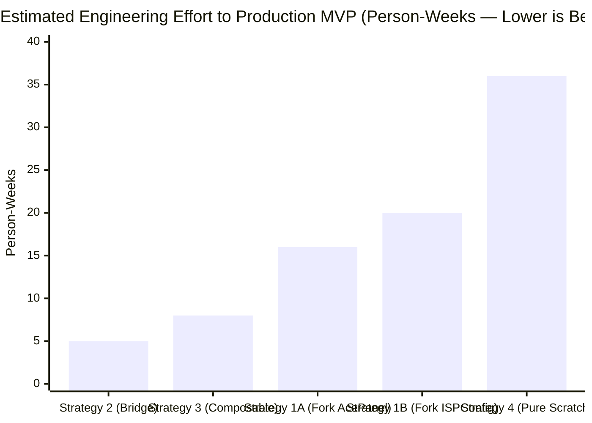
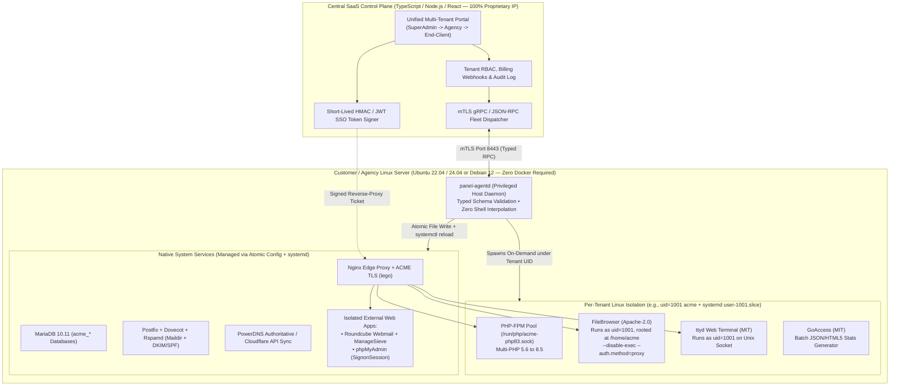

# 10 — Build vs. Leverage Decision Blueprint & MVP Implementation Roadmap

> **Executive Summary:** Having audited 11 open-source repositories ([`docs/data/competitor_empirical_metrics.json`](file:///home/robert/projects/cpanel-clean-room/docs/data/competitor_empirical_metrics.json)) and scored all 68 HostGator cPanel features plus 10 SaaS product readiness gates ([`docs/data/competitor_gap_matrix.json`](file:///home/robert/projects/cpanel-clean-room/docs/data/competitor_gap_matrix.json)), we can definitively answer our core strategic question: **Should we adopt/fork an existing panel, wrap one headlessly, compose modular OSS subsystems with a thin clean-room control plane, or write everything from scratch?**
>
> **The Verdict:** **Strategy 3 (Composable Permissive OSS Subsystems + Clean-Room Go Host Agent & TypeScript SaaS Control Plane)** wins by an overwhelming margin—delivering **97.1% cPanel feature parity** (`100%` on P0 & P1 features) and **100% SaaS Product Readiness** in **~8 person-weeks**, compared to **36 person-weeks** for a pure from-scratch build (`Strategy 4`) or **16–20 person-weeks** of painful architectural retrofitting when forking `AcePanel` or `ISPConfig 3` (`Strategy 1`). For immediate Day-0 tactical migrations before Week 8, **Strategy 2 (Headless Virtualmin/Hestia CLI Bridge)** can optionally serve as a disposable 4-week adapter on dedicated VMs without contaminating our intellectual property.

---

## 1. Head-to-Head Comparison of the 4 Engineering Strategies

The table below directly reflects the `strategyComparison` model computed in [`docs/data/competitor_gap_matrix.json`](file:///home/robert/projects/cpanel-clean-room/docs/data/competitor_gap_matrix.json):

| Dimension | Strategy 1A: Fork `AcePanel` (`BSD-3-Clause` Go) | Strategy 1B: Fork `ISPConfig 3` (`BSD-3`) or `HestiaCP` (`GPLv3`) | Strategy 2: Headless `Virtualmin` / `Hestia` + Custom SaaS UI | **Strategy 3 (WINNER): Composable OSS + Clean-Room Go/TS Agent** | Strategy 4: 100% Pure From-Scratch Build |
| :--- | :--- | :--- | :--- | :--- | :--- |
| **Commercial SaaS License Viability** | ✅ **PASS** (`BSD-3-Clause`) | ⚠️ `ISPConfig`: **PASS** ❌ `Hestia`/`Virtualmin`: **FAIL** (`GPLv3`) | ✅ **PASS via Network IPC** (Unmodified GPLv3 daemon called over HTTPS) | ✅ **100% PASS** (`MIT`/`Apache-2.0` binaries + 100% First-Party IP) | ✅ **100% PASS** (100% First-Party IP) |
| **Starting cPanel Feature Parity** | `58.2%` (`67.5%` P0) | `84.4%` (`ISPConfig`) / `82.4%` (`Hestia`) | `93.0%` (`Virtualmin`) / `82.4%` (`Hestia`) | **`97.1%` (`100%` P0 & P1)** | `0.0%` |
| **Starting SaaS Product Fit** | `51.0%` | `61.0%` (`ISPConfig`) / `39.0%` (`Hestia`) | `68.3%` | **`100.0%`** | `0.0%` |
| **Estimated MVP Effort** | **`16 person-weeks`** | **`20 person-weeks`** | **`5 person-weeks`** (Tactical Bridge) | **`8 person-weeks`** | **`36 person-weeks`** |
| **Inherited Technical & Security Debt** | **Moderate-High:** Must rip out single-user (`www`) assumptions across `685` Go files (`107k LOC`) to add Linux UID isolation, Mail, DNS, and `cpmove`. | **Extreme:** `247k LOC` of 2008-era PHP + 60s cron polling (`ISPConfig`), or `526` `sudo` Bash scripts with `26` GHSAs (`HestiaCP`). | **Medium:** Zero fork debt, but customer VPSs require fresh OS installs with heavy Perl (`733k LOC`) or Exim/Bash stacks. | **Zero:** ~3,500 LOC Go agent + ~4,500 LOC TS/React UI; heavy utilities delegated to battle-tested C/Go binaries. | **High Maintenance:** Permanently maintaining custom File Manager, Webmail, SQL GUI, and Log Parser in-house. |
| **Final Strategic Verdict** | ❌ **Reject Full Fork** (Reference Go `pkg/` helpers only) | ❌ **Reject Fork** | ⚡ **Optional Phase-0 Bridge Only** | 🏆 **PRIMARY ARCHITECTURE** | ❌ **Reject Reinventing Commodity Wheels** |

---

## 2. Why Strategy 3 Wins: The "80% Leverage / 20% Clean-Room Glue" Principle

When engineers estimate building a cPanel competitor from scratch (`Strategy 4` = **36 person-weeks**), **78% of that time (28 person-weeks)** is consumed by five massive, complex user-facing subsystems that have **zero business differentiation**:

| Complex cPanel Subsystem | Effort If Built From Scratch (`Strategy 4`) | Strategy 3 Composable OSS Solution | License & Footprint | Effort to Embed with SSO (`Strategy 3`) |
| :--- | ---: | :--- | :--- | ---: |
| **1. Web File Manager, Code Editor, Zip/Tar Extractor & Chmod** (`FIL-01`..`04`) | `6.0 weeks` | **`FileBrowser`** (`filebrowser/filebrowser`) | `Apache-2.0` (`28.9k LOC` Go/Vue single binary) | **`0.5 weeks`** (Unix socket + `--auth.method=proxy` + `--disable-exec`) |
| **2. Full Webmail Client, Sieve Filter UI & Autoresponder GUI** (`EML-01`,`04`,`08`,`09`) | `10.0 weeks` | **`Roundcube Webmail`** + `managesieve` plugin | `GPL-3.0` external app via HTTP/HMAC SSO (`oauth`/`autologon` plugin) | **`0.5 weeks`** |
| **3. MySQL Schema Browser, Table Editor & SQL Runner** (`DB-01`) | `6.0 weeks` | **`phpMyAdmin`** (with `SignonSession` / `SignonURL`) | `GPL-2.0` external app via PHP session token handoff | **`0.3 weeks`** |
| **4. Browser WebSocket Terminal Emulator** (`ADV-01`, `SEC-01`) | `2.0 weeks` | **`ttyd`** (`tsl0922/ttyd`) | `MIT` (`19.4k LOC` C + `xterm.js`, `0` GHSAs) | **`0.3 weeks`** |
| **5. Real-Time Web Traffic & Visitor Log Analyzer** (`MET-01`,`03`,`05`) | `3.0 weeks` | **`GoAccess`** (`allinurl/goaccess`) | `MIT` (`46.9k LOC` C single binary outputting JSON/HTML5) | **`0.4 weeks`** |
| **6. Deduplicated Encrypted Backup Engine** (`FIL-07`,`10`) | `3.0 weeks` | **`restic`** (or `kopia`) + custom `cpmove` parser | `BSD-2-Clause` static Go binary | **`0.5 weeks`** |
| **Subtotal for Commodity Subsystems** | **`30.0 weeks`** | **6 Battle-Tested Upstream Projects** | **100% Commercial SaaS Safe** | **`2.5 weeks`** |

That leaves only **~5.5 person-weeks** of high-value, first-party engineering for our core intellectual property:
1. **`panel-agentd` (~3,500 LOC Go/TS):** The privileged daemon running on each target Linux server.
2. **The `cpmove` Archive Importer (~900 LOC):** Native 1-click migration from any cPanel host (`HostGator`, `Bluehost`, `GoDaddy`, `SiteGround`).
3. **`CleanPanel Control Plane` (~4,500 LOC TypeScript/React):** The multi-tenant portal with `SuperAdmin → Agency/Reseller → End-Client` RBAC and one-click SSO into the embedded subsystems.

---

## 3. Architectural Blueprint of Strategy 3

---

## 4. Clean-Room Specification: The 22 Atomic Host Agent Operations (`panel-agentd`)

Rather than HestiaCP's **526 Bash scripts** (`65,725 LOC` of shell string concatenation that produced 26 security advisories), `panel-agentd` exposes **22 strongly-typed, schema-validated RPC handlers** that use `execFile` with explicit argument arrays (never `sh -c`) and atomic temp-file renames:

| Domain | RPC Method | Native Linux Action Performed by `panel-agentd` |
| :--- | :--- | :--- |
| **1. Tenant Lifecycle** | `tenant.create` | Creates Linux group/user (`useradd -m -d /home/<u > -s /bin/bash`), writes `/etc/systemd/system/user-<uid>.slice` (`CPUQuota`, `MemoryMax`, `TasksMax`), sets `setquota` on `/` or `/home`. |
| | `tenant.updateLimits` | Updates `user-<uid>.slice` drop-in and filesystem block/inode quotas live via `systemctl daemon-reload`. |
| | `tenant.suspend` / `resume` | Locks password (`usermod -L`), swaps Nginx vhosts to maintenance page, disables Postfix/Dovecot login flag. |
| **2. Web & Multi-PHP** | `site.upsert` | Renders `/etc/nginx/sites-available/<domain>.conf` and `/etc/php/<ver>/fpm/pool.d/<user>-<domain>.conf` (`user = <user>`, `open_basedir`), runs `nginx -t`, reloads FPM & Nginx. |
| | `site.setPhpVersion` | Atomically moves pool config between `/etc/php/{5.6..8.5}/fpm/pool.d/` and reloads target FPM daemons (`SOF-05`). |
| | `site.updatePhpIni` | Updates `php_admin_value` / `php_admin_flag` directives in the tenant's FPM pool (`SOF-06`). |
| | `site.issueSsl` | Uses embedded Go `lego` ACME library (`HTTP-01` or `DNS-01`) to issue/renew Let's Encrypt certs (`SEC-03`, `SEC-07`). |
| **3. Databases** | `mysql.createDb` / `dropDb` | Connects to local `/run/mysqld/mysqld.sock` via Go `go-sql-driver/mysql` using parameterized DDL (`CREATE DATABASE \`acme_app\``). |
| | `mysql.upsertUserGrant` | Creates `<user>_<dbuser>@localhost` (or remote IP for `DB-04`) and applies scoped `GRANT` privileges. |
| | `mysql.createPmaSession` | Mints a 60-second encrypted `SignonSession` cookie payload for 1-click phpMyAdmin SSO (`DB-01`). |
| **4. Mail & Deliverability** | `mail.upsertDomain` | Registers domain in `/etc/postfix/vhosts` and generates 2048-bit RSA + Ed25519 DKIM keys in `/var/lib/rspamd/dkim/` (`EML-10`). |
| | `mail.upsertAccount` | Writes `Argon2id`/`SHA512-CRYPT` hash and quota to `/etc/dovecot/passwd` and provisions `/home/<user>/mail/<domain>/<localpart>/Maildir` (`EML-01`). |
| | `mail.upsertForwarder` | Updates `/etc/postfix/virtual` and runs `postmap /etc/postfix/virtual` (`EML-02`, `EML-05`). |
| | `mail.upsertSieve` | Writes vacation autoresponder or filter script to `/home/<user>/mail/<domain>/<localpart>/.dovecot.sieve` and compiles with `sievec` (`EML-04`, `EML-08`, `EML-09`). |
| **5. Authoritative DNS** | `dns.upsertZone` | Updates PowerDNS SQLite/MariaDB backend (or syncs via Cloudflare API) and increments `SOA` serial (`DOM-03`, `DOM-04`). |
| **6. Subsystems & SSO** | `sso.openFileBrowser` | Ensures tenant's isolated `filebrowser` instance is listening on `/run/winwin/fb-<user>.sock` and returns signed proxy ticket (`FIL-01`). |
| | `sso.openTerminal` | Spawns on-demand `ttyd` bound to `/run/winwin/ttyd-<user>.sock` under `uid=<user>` and returns signed WebSocket ticket (`ADV-01`). |
| | `stats.generateGoAccess` | Runs `goaccess` against `/var/log/nginx/<domain>.access.log` outputting JSON + static HTML (`MET-01`..`05`). |
| **7. Cron & SSH** | `cron.syncJobs` | Writes validated crontab to `/etc/cron.d/tenant-<user>` with explicit `USER=<user>` (`ADV-02`). |
| | `ssh.syncAuthorizedKeys` | Atomically updates `/home/<user>/.ssh/authorized_keys` (`0600`, owned by `<user>`) (`SEC-01`). |
| **8. Backup & Migration** | `backup.importCpmove` | Streams and restores a cPanel `backup-*.tar.gz` / `cpmove-<user>.tar.gz` archive (see Section 5 below). |
| | `backup.runRestic` | Executes deduplicated `restic` snapshot of `/home/<user>`, `/var/lib/mysql/<user>_*`, and metadata to S3/B2 (`FIL-07`, `FIL-10`). |

---

## 5. Clean-Room `cpmove` Importer Specification (Inspired by Virtualmin's `migration-cpanel.pl`)

Our empirical audit of `Virtualmin GPL` (`scratch/competitor-repos/virtualmin-gpl/migration-cpanel.pl`, `1,702 LOC`) confirmed that a cPanel full backup archive (`backup-MM.DD.YYYY_HH-MM-SS_<user>.tar.gz` or `cpmove-<user>.tar.gz`) follows a deterministic directory layout that our Go agent can unpack and hydrate in **~900 lines of clean-room Go**:

| Path Inside `cpmove-<user>.tar.gz` | Contents | `panel-agentd` Clean-Room Restoration Action |
| :--- | :--- | :--- |
| `cp/<user>` | Key-value account metadata (`DNS=example-store.com`, `PLAN=...`, `MAXFTP=...`) | Parses primary domain, contact email, and quota limits. |
| `userdata/main` & `userdata/<domain>` | YAML/JSON mapping of Addon Domains (`addon_domains`), Subdomains (`sub_domains`), Parked Aliases, and `documentroot` paths + PHP version | Calls `site.upsert` for primary domain (`public_html`) and every addon domain (`legacy-crm.org`, `directory-hub.net`, etc.) with its matching PHP-FPM version (`5.6`–`8.5`). |
| `homedir/` or `homedir.tar` | Complete `/home/<user>/` filesystem including `public_html/`, `mail/`, and `etc/` | Extracts into `/home/<user>/`, normalizes ownership (`chown -R <uid>:<gid>`), and strips legacy HostGator EasyApache `.htaccess` `AddHandler application/x-httpd-ea-php*` lines that conflict with Nginx/PHP-FPM. |
| `mysql/<dbname>.sql` & `mysql.sql` | Full `mysqldump` schema + data for every `<user>_*` database (`acme_store.sql`, `acme_crm.sql`) + `GRANT` statements | Creates databases and users in MariaDB, imports `.sql` dumps via streaming pipe, and preserves existing database passwords from `mysql.sql` `IDENTIFIED BY PASSWORD` hashes so `wp-config.php` works with **zero edits**. |
| `homedir/etc/<domain>/passwd` & `shadow` | Dovecot-compatible `CRAM-MD5` / `SHA512-CRYPT` (`$6$...`) password hashes and byte quotas for every mailbox | Imports password hashes directly into `/etc/dovecot/passwd` so existing IMAP/SMTP clients (`Outlook`, `Apple Mail`, `Thunderbird`) stay connected **without resetting user passwords**. |
| `homedir/mail/<domain>/<user>/` | Standard `Maildir/` hierarchy (`cur/`, `new/`, `tmp/`, `.Sent/`, `.Trash/`) | Preserves in place under `/home/<user>/mail/<domain>/<user>/` and runs `doveadm index` to rebuild Dovecot indexes. |
| `valiases/<domain>` | Forwarder & catch-all mappings | Populates `/etc/postfix/virtual` forwarders (`EML-02`, `EML-05`). |
| `dnszones/<domain>.db` | Standard RFC 1035 BIND zone files | Parses via Go `miekg/dns` library and imports records into PowerDNS / Cloudflare (`DOM-03`). |
| `cron/<user>` | User crontab entries | Rewrites PHP CLI paths (`/opt/cpanel/ea-php82/root/usr/bin/php` → `/usr/bin/php8.2`) and installs into `/etc/cron.d/tenant-<user>` (`ADV-02`). |

---

## 6. 8-Week MVP Execution Roadmap (Strategy 3)

| Phase | Timeline | Deliverables | Verification Milestone |
| :--- | :---: | :--- | :--- |
| **Phase 1: Core Host Agent (`panel-agentd`) & Linux Isolation** | **Weeks 1–2** | • Privileged daemon (`panel-agentd`) • Tenant UID + `systemd` `user-<uid>.slice` + quota provisioning • Nginx + Multi-PHP FPM (`5.6`–`8.5`) + `lego` AutoSSL • MariaDB database/user manager | Provision `example-store.com` & `legacy-crm.org` on a staging Ubuntu 24.04 VPS with isolated PHP 8.2 / 7.4 FPM pools and Let's Encrypt TLS. |
| **Phase 2: Composable OSS Subsystem Integration & SSO** | **Weeks 3–4** | • Embed `FileBrowser` (`Apache-2.0`, `--disable-exec`, `--auth.method=proxy`) • Embed `ttyd` (`MIT`) & `GoAccess` (`MIT`) • Configure `phpMyAdmin` `SignonSession` & `Roundcube` HMAC SSO | Verify 1-click passwordless launch of File Manager, Web Terminal, phpMyAdmin, and Visitor Analytics from a single test token. |
| **Phase 3: Native Mail Stack & Authoritative DNS** | **Weeks 5–6** | • Postfix + Dovecot + Rspamd + ManageSieve integration • Automated DKIM (`Ed25519`/`RSA`), SPF, and DMARC provisioning • PowerDNS + Cloudflare API Zone Editor (`DOM-03`) | Send and receive external email with `10/10` `mail-tester.com` DKIM/SPF/DMARC score; verify Sieve vacation autoresponders. |
| **Phase 4: `cpmove` Importer & Multi-Tenant UI (Dogfood #1: `acme`)** | **Weeks 7–8** | • Clean-room `cpmove` archive importer • React/TypeScript Control Plane matching our Jupiter UI blueprints ([`docs/06`](file:///home/robert/projects/cpanel-clean-room/docs/06-clean-room-control-panel-architecture.md)) • Full dry-run migration of reference HostGator `backup-*.tar.gz` | Upload reference HostGator `cpmove` backup; verify all domains, MySQL DBs (`acme_store`, `acme_crm`), mailboxes, and files restore and pass HTTP/visual verification in < 5 minutes. |
