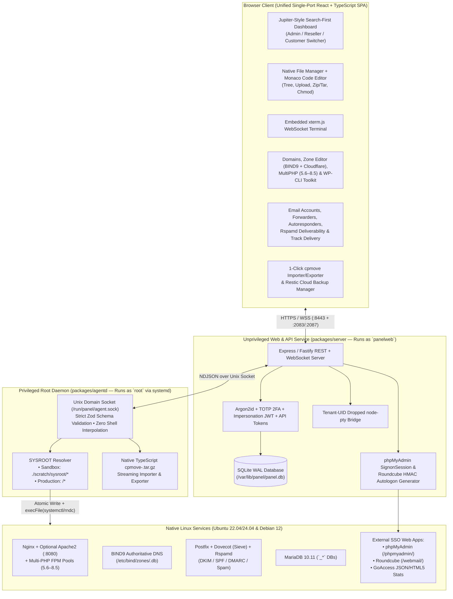

# 11 — Architecture Decision Records (ADR-01 to ADR-11) & Full-Stack TypeScript MVP Specification

> **Executive Summary:** Through an 11-point interactive design review (`/grill-me`), we locked in every architectural decision required to build our standalone open-source/commercial cPanel replacement right inside [`/home/robert/projects/cpanel-clean-room`](file:///home/robert/projects/cpanel-clean-room). This document records the canonical **Architecture Decision Records (`ADR-01` through `ADR-11`)**, the monorepo package structure, the `PANEL_SYSROOT` dual-mode sandbox/production engine, the SQLite schema, and the IPC protocol between the unprivileged Web/API server and the privileged root Unix-socket daemon.

---

## 1. Summary Matrix of Locked Architecture Decision Records (`ADR-01` – `ADR-11`)

| ADR ID | Decision Area | Locked Architecture Choice | Rationale & Advantage Over Legacy Panels |
| :--- | :--- | :--- | :--- |
| **`ADR-01`** | **Control Plane Topology** | **Standalone Single-Server Appliance** (Classic cPanel/Hestia model) | Every server is self-contained with its own UI, SQLite state, and daemon—zero external SaaS dependency or single point of failure. |
| **`ADR-02`** | **Core Backend Runtime** | **100% TypeScript / Node.js Stack** (`Fastify`/`Express` + `React` + `better-sqlite3` + TS Root Socket Daemon) | 100% shared TypeScript & Zod schemas across UI, API, and root daemon; maximum engineering velocity. |
| **`ADR-03`** | **Multi-Tenant Role Hierarchy & Ports** | **Unified Single-Port SPA with 3-Tier RBAC (`Admin` → `Reseller` → `Customer`) & 1-Click Impersonation** (+ `:2083`/`:2087`/`:2096` aliases) | Eliminates WHM vs. cPanel code duplication while preserving classic port redirects and 1-click customer support impersonation. |
| **`ADR-04`** | **Web Server & `.htaccess` Engine** | **Pure `Nginx + PHP-FPM` by Default** (with automated `.htaccess`-to-Nginx converter & presets) + **Optional Per-Site `Apache2` Backend (`127.0.0.1:8080`)** | Delivers pure Nginx performance for 95% of sites while guaranteeing a 1-click escape hatch for complex legacy `.htaccess` apps. |
| **`ADR-05`** | **Authoritative DNS & Zone Editor** | **Local `BIND9` (`RFC 1035` `/etc/bind/zones/<domain>.db` + `rndc reload`) + Optional Per-Domain Cloudflare API Two-Way Sync** | Directly compatible with `cpmove` `dnszones/*.db` files with zero extra SQL daemon overhead, plus native Cloudflare API sync. |
| **`ADR-06`** | **Mail, DKIM & Spam Stack** | **`Postfix` + `Dovecot` (Maildir + Pigeonhole ManageSieve) + `Rspamd` + `Roundcube Webmail` SSO** | Replaces 1.2 GB+ RAM `SpamAssassin`/`ClamAV`/`OpenDKIM` sprawl with `Rspamd`'s unified ~60 MB RAM C/Lua engine + JSON stats API. |
| **`ADR-07`** | **Web File Manager (`FIL-01`)** | **Native React File Explorer + Monaco Code Editor inside our Panel SPA** | Eliminates `FileBrowser`'s 30 historical GHSAs, provides a 100% unified dark/light UI theme, and executes `tar`/`zip`/`chmod` via typed tenant-UID RPCs. |
| **`ADR-08`** | **Terminal, SQL GUI & Webmail (`ADV-01`, `DB-01`, `EML-01`)** | **Native `@xterm/xterm` + `node-pty` WebSocket Terminal in React UI** + **1-Click Passwordless SSO into `phpMyAdmin` (`SignonSession`) & `Roundcube`** | Gives developers an embedded IDE-grade terminal right next to Monaco Editor while keeping industry-standard `phpMyAdmin` and `Roundcube`. |
| **`ADR-09`** | **Backup & cPanel Migration (`FIL-07`/`08`/`10`)** | **Dual-Engine Backup:** **100% `cpmove-<user>.tar.gz` Import & Export** + **Scheduled `restic` Encrypted Deduplicated Backups (S3/B2/R2/SFTP)** | Guarantees 1-click migration from HostGator/Bluehost/GoDaddy *and* zero-lock-in `.tar.gz` exports alongside modern deduplicated cloud snapshots. |
| **`ADR-10`** | **Application Runtimes & 1-Click Installer (`SOF-04`/`05`/`07`)** | **Multi-PHP FPM (`5.6`–`8.5`) + Native `WP-CLI` WordPress Toolkit + Node.js/Python `systemd` App Runner** | Covers legacy PHP (`legacy-crm.org`), modern WordPress (`example-store.com`), and modern Node.js/Python apps behind Nginx. |
| **`ADR-11`** | **Target OS, Sysroot Sandbox & Repo Structure** | **Ubuntu 22.04/24.04 & Debian 12 (`apt`)** + **Dual `PANEL_SYSROOT` (`sandbox` in `scratch/sysroot` vs. `production` in `/`)** inside `/home/robert/projects/cpanel-clean-room` | Allows 100% safe, non-destructive development, automated E2E testing, and live UI verification on developer workstations without touching host `/etc`. |

---

## 2. System Architecture & Process Isolation Diagram



---

## 3. Repository Monorepo Layout (`/home/robert/projects/cpanel-clean-room`)

We structure the repository as a clean npm workspace monorepo alongside our existing `docs/` and `scripts/`:

```text
/home/robert/projects/cpanel-clean-room/
├── docs/                                # Complete Clean-Room Docs (01..11), Screenshots & Datasets
├── scripts/                             # Inventory, Screenshot, Competitor Audit & Verification CLI
├── packages/
│   ├── shared/                          # Shared TypeScript interfaces, Zod RPC schemas, constants
│   │   └── src/
│   │       ├── rpc-schema.ts            # Strongly-typed Zod schemas for all 24 agentd operations
│   │       ├── models.ts                # Account, Domain, DnsRecord, Mailbox, Database, Backup types
│   │       └── htaccess-translator.ts   # Deterministic Apache .htaccess -> Nginx rule converter
│   ├── agentd/                          # Privileged Root Daemon (panel-agentd)
│   │   └── src/
│   │       ├── index.ts                 # Unix socket server (/run/panel/agent.sock)
│   │       ├── sysroot.ts               # Dual-mode Sandbox (scratch/sysroot) vs Production (/) engine
│   │       ├── handlers/
│   │       │   ├── tenant.ts            # useradd, user-<uid>.slice cgroups, quota
│   │       │   ├── web-php.ts           # Nginx vhost, optional Apache2 proxy, PHP-FPM 5.6-8.5 pools, ACME SSL
│   │       │   ├── dns-bind.ts          # RFC 1035 BIND9 zone writer/parser + Cloudflare API sync
│   │       │   ├── mail-rspamd.ts       # Postfix virtual maps, Dovecot passwd/Maildir/Sieve, Rspamd DKIM
│   │       │   ├── mysql.ts             # MariaDB database/user/grant provisioning & SignonSession
│   │       │   ├── files.ts             # Tenant-UID dropped fs operations (list, read, write, chmod, zip/tar)
│   │       │   ├── wp-toolkit.ts        # WP-CLI install, clone, auto-update, wp-admin SSO
│   │       │   └── cpmove.ts            # Full cPanel backup-*.tar.gz / cpmove importer & exporter + restic
│   ├── server/                          # Unprivileged Web API & WebSocket Server (panel-server)
│   │   └── src/
│   │       ├── index.ts                 # Express/Fastify HTTP + WS server (serves API + compiled SPA)
│   │       ├── db/                      # SQLite (better-sqlite3) schema, migrations, and seed data
│   │       ├── auth/                    # Argon2id/scrypt auth, TOTP 2FA, RBAC, 1-click user impersonation
│   │       ├── ws/                      # xterm.js WebSocket terminal & real-time log tailing
│   │       └── routes/                  # REST endpoints for all 9 cPanel categories + Admin/Reseller WHM views
│   └── web/                             # React + TypeScript + Vite + Tailwind Frontend SPA
│       └── src/
│           ├── components/              # Jupiter-inspired Left Sidebar, Quick Search (/), Right Telemetry Rail
│           └── pages/
│               ├── DashboardPage.tsx    # 9-Category cPanel Grid + Server/Account Health Telemetry
│               ├── AdminAccountsPage.tsx# WHM-equivalent Account List, Packages & 1-Click Impersonation
│               ├── FileManagerPage.tsx  # Dual-pane File Tree + Monaco Code Editor + Upload/Extract/Chmod
│               ├── TerminalPage.tsx     # Embedded xterm.js Terminal Drawer/Page
│               ├── DomainsDnsPage.tsx   # Domains, Redirects, BIND9/Cloudflare Zone Editor & AutoSSL
│               ├── EmailSuitePage.tsx   # Mailboxes, Forwarders, Sieve Autoresponders, DKIM/SPF & Roundcube SSO
│               ├── DatabasesPage.tsx    # MySQL DBs, Users, Remote IPs, 1-Step Wizard & phpMyAdmin SSO
│               ├── MultiPhpWpPage.tsx   # MultiPHP Manager (5.6–8.5), INI Editor, WP-CLI Toolkit & Node Apps
│               └── BackupsCpmovePage.tsx# 1-Click cPanel cpmove Migration Importer/Exporter & Restic Cloud Backups
```

---

## 4. Dual-Mode `PANEL_SYSROOT` Engine (`Sandbox` vs. `Production`)

To guarantee that we can develop, run automated tests, and visually verify every single workflow on `agents@darter` without touching host `/etc`, `packages/agentd/src/sysroot.ts` enforces strict path resolution:

| System Target Path (`production` mode: `PANEL_SYSROOT=/`) | Sandbox Target Path (`sandbox` mode: `PANEL_SYSROOT=./scratch/sysroot`) | Generated File Format |
| :--- | :--- | :--- |
| `/home/<user>/public_html` | `./scratch/sysroot/home/<user>/public_html` | Real directory tree editable in our React File Manager & Monaco Editor |
| `/etc/nginx/sites-available/<domain>.conf` | `./scratch/sysroot/etc/nginx/sites-available/<domain>.conf` | Production-grade Nginx vhost config (`fastcgi_pass`, SSL, `.htaccess` rewrites) |
| `/etc/php/<ver>/fpm/pool.d/<user>-<domain>.conf` | `./scratch/sysroot/etc/php/<ver>/fpm/pool.d/<user>-<domain>.conf` | Isolated FPM pool config (`user = <user>`, `php_admin_value`) |
| `/etc/bind/zones/<domain>.db` | `./scratch/sysroot/etc/bind/zones/<domain>.db` | Valid RFC 1035 BIND9 zone file (`$TTL`, `SOA`, `NS`, `A`, `MX`, `TXT` DKIM/SPF) |
| `/etc/postfix/virtual` & `/etc/dovecot/passwd` | `./scratch/sysroot/etc/postfix/virtual` & `./scratch/sysroot/etc/dovecot/passwd` | Real Postfix alias tables and Dovecot `SHA512-CRYPT`/`Argon2id` passwd files |
| `/var/lib/rspamd/dkim/<domain>.dkim.key` | `./scratch/sysroot/var/lib/rspamd/dkim/<domain>.dkim.key` | Real generated 2048-bit RSA / Ed25519 DKIM keypair + DNS `TXT` record |
| `/etc/systemd/system/user-<uid>.slice` | `./scratch/sysroot/etc/systemd/system/user-<uid>.slice` | Real `systemd` `cgroups v2` resource slice (`CPUQuota`, `MemoryMax`, `TasksMax`) |
| `/etc/cron.d/tenant-<user>` | `./scratch/sysroot/etc/cron.d/tenant-<user>` | Validated system cron file with explicit `USER=<user>` |

---

## 5. Implementation Milestones

1. **Milestone 1 — Shared Contracts, SQLite State & Privileged `panel-agentd` Daemon (`packages/shared` + `packages/agentd`)**:
   - Implement the Zod-validated Unix socket RPC protocol, `PANEL_SYSROOT` engine, `.htaccess`-to-Nginx converter, RFC 1035 BIND9 zone parser/writer, RSA/Ed25519 DKIM generator, and streaming `cpmove` `.tar.gz` importer/exporter.
2. **Milestone 2 — Unprivileged API Server & Pre-Seeded `acme` Reference Account (`packages/server`)**:
   - Implement `better-sqlite3` database, 3-tier RBAC (`admin`, `reseller`, `acme`), REST APIs for all 9 cPanel categories, `node-pty` WebSocket terminal, and seed reference domains (`example-store.com`, `legacy-crm.org`, `directory-hub.net`, `studio-letters.com`), databases (`acme_store`, `acme_crm`), DNS zones, and Multi-PHP pools into `scratch/sysroot`.
3. **Milestone 3 — Jupiter-Modernized React + Monaco + `xterm.js` Control Panel SPA (`packages/web`)**:
   - Build the unified Admin/Reseller/Customer UI with `/`-hotkey instant search, 1-click user impersonation, Native File Manager + Monaco Code Editor, WebSocket Terminal, Zone Editor, Email & Deliverability Suite, MultiPHP + WP-CLI Toolkit, and 1-Click `cpmove` Backup Importer/Exporter.
4. **Milestone 4 — End-to-End Integration Test Suite & Visual Verification**:
   - Verify all API endpoints, generated `scratch/sysroot/etc/*` configurations, `cpmove` archive round-trip import/export, and HTTP/asset verification of the live running panel.
